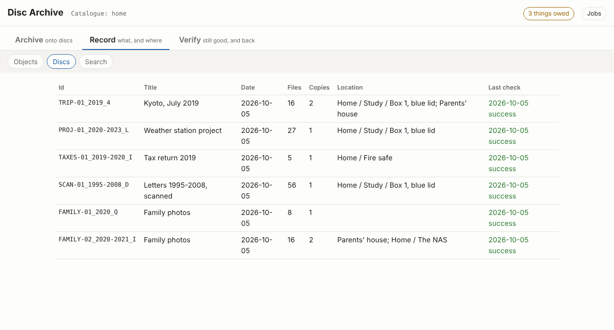
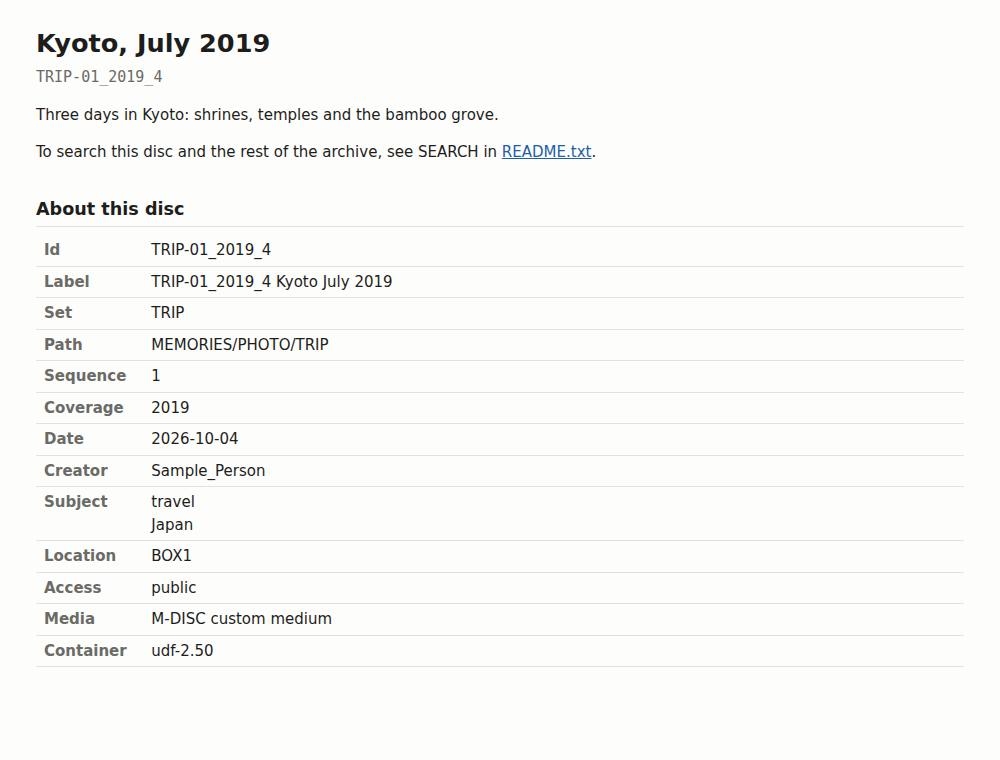

# ARV: Archive, Record, Verify

> [!WARNING]
> **Experimental. Do not trust your only copy of anything to this yet.**
> No disc made with it has been burned and read back over years; the disc format is a draft
> (0.5) and may still change in ways older discs do not follow. Keep your data where it is
> now, and treat discs made with this as an extra copy while you test it.
>
> **Written largely by an AI coding assistant** ("vibe-coded"), with a human choosing the
> direction and reviewing the results. It has tests, but it has not had the scrutiny of a
> mature project: read the code before relying on it, check what it produces, and expect
> bugs. Provided as is, with no warranty (see [LICENSE](LICENSE)).

**ARV** (`arv`; also Norwegian for "inheritance") is for **long-term archiving, not backup**.

| | A backup | An archive |
|---|---|---|
| Holds | everything, as it is now | what is worth keeping, chosen |
| For | getting back what you lost last week | your grandchildren, decades from now |
| Lives | as long as the current copy; replaced by the next one | longer than the software and the person who made it |
| Kept | online: always connected, so one mistake, failure or ransomware reaches it | **cold** where possible: offline media on a shelf, untouched until needed, copies in other places |
| Read with | the backup program that wrote it | anything: plain files, open formats, the steps on the disc itself |
| Knows | file contents | what each thing is, where every copy is, when it was last checked, why it matters |

Keep your backups (the NAS, restic, Borg, the cloud): arv sits on top of them, for the photos,
video, documents and source code that should outlive them, and puts them in cold storage
(write-once discs today) whenever it can. It is a personal archivist's tool, and its name is
what it does:

- **Archive: what goes on discs.** A folder you sort and grow becomes a *collection* with its
  own history: each set of discs made from it is an edition, and arv says what changed between
  editions, and since the last. Or compose discs by hand from files and folders anywhere, as Nero's
  compilation window did (`arv plan`). Each disc holds part of a collection and a copy of the catalogue,
  so any one of them can tell you about the whole archive.
- **Record: what exists, and where.** Which files are on which discs and which are on none; each
  thing you archived as a *data object*, in versions, recognised by its content; every copy, its
  place down to the box, and its temperature (hot, warm, cold); appraisals (how important, to
  whom, why) and a log of every change, people's and machines' told apart (`arv objects`,
  `arv find`, `arv status`).
- **Verify: still good, and can be got back.** A copy is recorded only once it reads back
  identical; checks come round every few years; `arv todo` says what is owed: copies, read-backs,
  cold copies, places, checks. Every disc carries error correction, the tools to repair it, and
  the catalogue to rebuild the record from (`arv check`, `arv restore`, `arv rebuild`).

`arv --help`, the GUI's three tabs and [docs/workflow.md](docs/workflow.md) are arranged the same way.
**See it**: a [recorded session](https://mofosyne.github.io/arv/#see-it) of all three, run for real
([docs/demo/arv.cast](docs/demo/arv.cast); `asciinema play docs/demo/arv.cast` in a terminal).

What it writes are self-describing archive discs: your files untouched, a hash of every file,
a catalogue of the whole archive so far, the source of the tools that made it, and the steps to
check and repair it, with error correction filling the rest of the disc. All in open,
well-documented formats that can be read decades from now without this tool. Blu-ray (M-DISC
BD-R) is today's medium; the format does not depend on it.

Why it works the way it does (curated discs on top of everyday storage, plain files, copies): [docs/philosophy.md](docs/philosophy.md). The model behind the commands — collections, archives, copies, and how objects and folders relate: [docs/concepts.md](docs/concepts.md).

**Start with [docs/workflow.md](docs/workflow.md)**: the whole flow, from a folder to discs on a
shelf, finding and checking them over the years, and recovering from damage or loss.
[docs/burning.md](docs/burning.md) is how to burn and check a disc (and the drill for a new drive or
media); [docs/shelving.md](docs/shelving.md) covers arranging, labelling and storing the physical discs.
How a disc is built, in one picture: [docs/architecture.md](docs/architecture.md).

## Disc layout

```
<disc root>                  filesystem: UDF 2.50 (BD-ROM layout, metadata partition with a real mirror)
├── bagit.txt                BagIt signature (RFC 8493)
├── bag-info.txt             Bagging-Date, Bag-Group-Identifier, Bag-Count "n of N", Payload-Oxum
├── manifest-sha256.txt      per-file checksums (`sha256sum -c` compatible)
├── manifest-sha512.txt
├── tagmanifest-sha256.txt   checksums of the files above + catalog.rec
├── catalog.rec              GNU recutils catalogue for this disc
├── catalog/                 snapshot of the whole archive catalogue at burn time
│                            (archive.rec, volumes/<disc-id>/: manifest, listing, formats, tags)
├── index.html               offline viewer (no JavaScript)
├── README.txt               plain-text recovery instructions
├── tools/                   this tool (its source and specs, as disc-tools.txt lists) and arv.com: the
│                            reader ready to run on Linux, macOS, Windows and BSD (x86-64, ARM64)
└── data/                    the payload
[ dvdisaster RS03 ECC data appended after the filesystem ]
```

Each layer does its own job:

| Layer | Purpose | Tool |
|---|---|---|
| dvdisaster RS03 (augmented image, [format](docs/spec/rs03-format.md)) | **Repair** unreadable sectors | `arv check --repair`, or any `dvdisaster` |
| BagIt manifests | **Detect** corruption per file, portable off-disc | `arv check`, any BagIt tool ([note](docs/notes/bagit.md)), or plain `sha256sum -c` |
| recfile catalogue | **Find** which disc holds what, without mounting | `recsel`, `recfix` ([note](docs/notes/recutils.md)) |

## What's here

| Path | What |
|---|---|
| `src/arv/` | **arv**, a C program (C99 and POSIX, no libraries): every command, from making a disc to restoring one: [src/arv/README.md](src/arv/README.md) |
| `src/udfwrite/` | arv's UDF 2.50 writer (library, built into arv, and a program): [docs/spec/archival-udf.md](docs/spec/archival-udf.md) |
| `src/rs03/` | dvdisaster's RS03 error correction: add, test, repair (library, built into arv, and a program): [docs/spec/rs03-format.md](docs/spec/rs03-format.md) |
| `src/bagit/` | BagIt (RFC 8493) checking and the digests (library, built into arv, and a `bagit` program for any bag) |
| `src/arv-assist/` | **arv-assist**, optional, in C: describing and tagging (`arv describe`, `arv tag`): with OpenAI-compatible local services, or by asking you (`describe --ask`) |
| `src/arv-gui/` | **arv-gui**, optional, in C: `arv gui`, the interface in your web browser; a small local server that runs arv for every action |
| `arv` | runs `src/arv/build/arv` in a checkout (and `tools/arv/arv` on a disc), building it with `make` first if needed |
| `docs/` | For users: concepts, workflow, burning, shelving, architecture, philosophy, and the website |
| `docs/spec/` | For implementers, and on every disc: the disc format, the UDF profile, the RS03 error correction |
| `research/` | Why, and what next: research notes, the standards survey, organising lessons, the plan, RS03 experiments |
| `samples/` | The sample discs' catalogue and the script that makes them (the images are release downloads) |
| `tests/` | Unit and integration tests, and language-neutral fixtures |
| `dev-tools/` | Not part of arv: build and test helpers, the spec cross-check, the diagram generators: [dev-tools/README.md](dev-tools/README.md) |
| `upstream/` | Not part of arv: work offered to other projects (NetBSD makefs fixes, the RS03 code for dvdisaster Light; drafts, not sent), and bagit-python as a referee: [upstream/README.md](upstream/README.md) |
| `justfile`, `Makefile` | `just` lists everyday commands (test, install, samples, site preview); `make` alone builds and installs |

`samples/` has the catalogue of six small sample discs made with the full workflow (a
collection with two editions, a git repository, a sealed disc, a warm NAS copy): try
`./arv --home samples/home list` and `./arv --home samples/home todo`. The disc images themselves (105 MB, with RS03 error
correction) are in the [`samples` release](https://github.com/mofosyne/arv/releases/tag/samples);
`samples/fetch-discs.sh` downloads and checks them.

`research/plan.md` has the disc layout, phased plan and open decisions.

`docs/spec/smart-archive-format.md` specifies the on-disc catalogue format (draft 0.4) so other
cataloguing programs (e.g. Katalog) can read a disc and prefill their database without scanning it.

`research/metadata-standards.md` surveys archival metadata standards (Dublin Core,
PREMIS, METS, E-ARK, RO-Crate, OCFL, NDSA Levels...) and existing disc-cataloguing
software, and proposes this project's metadata profile.

`research/organising.md` collects what Katalog, Hydrus, Lightroom/digiKam, Paperless-ngx,
Johnny.Decimal and archival software teach about categories and structure, and what
was adopted (aliases, match rules, access levels, namespaced tags, location records).

`research/research-notes.md` explains the choices: why UDF 2.50/2.60 is hard to
produce on Linux and adds little over RS03, why dvdisaster is not a library,
and how BagIt and recfiles split the work.

## The `arv` tool

`arv` (Archive, Record, Verify; also Norwegian for "inheritance") is a C program: C99 and POSIX,
no libraries, built from any disc's `tools/` with one `cc` line. Two optional programs sit beside
it: arv-assist (C) has the local AI helpers, and arv-gui (C) the interface in your web
browser; arv runs them for `describe`, `tag`, `models` and `gui`. arv adds dvdisaster's RS03
error correction itself ([src/rs03](src/rs03/): byte for byte what dvdisaster writes), and
tests and repairs it, so making, checking and repairing discs needs nothing else. Reading a
damaged disc into an image is for GNU ddrescue or
[dvdisaster Light](https://github.com/teaching-droid/dvdisaster-light) (or the
[speed47 fork](https://github.com/speed47/dvdisaster)), which can also repair it.

### Install (Linux)

```sh
sudo apt install build-essential p7zip-full   # Debian/Ubuntu (python3 too, for make check)
# for reading damaged discs: gddrescue, or dvdisaster Light (https://github.com/teaching-droid/dvdisaster-light)
make install PREFIX=~/.local     # or: sudo make install   (/usr/local)
arv                              # where you are, and the commands to start with
```

With [just](https://github.com/casey/just), nothing to remember: `just install` (yourself, in
`~/.local`), `just install-system` (everyone, `/usr/local`, with sudo), the same with `uninstall`,
`just where` (which arv runs here), and `just deb` or `just arch` for a package. `just` lists them.
Uninstalling, either way, removes the programs and never your archives or discs.

Or as a package, so the package manager can remove it again ([packaging/](packaging/README.md)):
`just deb` for Debian and Ubuntu (`packaging/debian/`), `makepkg -si` in
`packaging/arch/` for Arch Linux. `make install` works from a release tarball too.

**Tab completion** is installed with it, for bash and zsh (`arv re<Tab>`, `arv burned --<Tab>`):
it asks arv itself what fits, so it follows the arv you have. In a checkout:
`source src/arv/completion/arv.bash`.

To put the ready-to-run reader on every disc, build `arv.com` (an [Actually Portable
Executable](https://justine.lol/ape.html): one file for Linux, macOS, Windows and the BSDs, x86-64
and ARM64) with [cosmocc](https://cosmo.zip/pub/cosmocc/) before installing:
`make ape COSMOCC=/path/to/cosmocc/bin/cosmocc`. Discs made from then on carry it as
`tools/arv.com`, and their README.txt says how to run it; without it they carry the source,
which builds with one `cc` line.

`make install` copies the last commit (exactly the tree every disc carries in `tools/`: what
[`disc-tools.txt`](disc-tools.txt) lists, about 5 MB, so not the UDF and ECMA standards) to
`PREFIX/share/arv` (with `arv.com` when it was built), puts `arv`, `arv-assist`, `arv-gui`,
`udfwrite` and `bagit` in `PREFIX/bin`, the completion where bash and zsh look for it, and **arv** in
the desktop's menu (`arv gui`, which stops by itself 15 minutes after its page is closed).

**`arv` does everything itself** ([src/arv/README.md](src/arv/README.md)) except four optional
commands: `arv describe` and `arv tag` run arv-assist
([src/arv-assist/README.md](src/arv-assist/README.md)), whose drafts `arv make --draft` takes, and
`arv gui` runs arv-gui ([src/arv-gui/README.md](src/arv-gui/README.md)). In a checkout, `./arv`
works the same way (it runs `make` first when nothing is built).

arv was ported to C from a Python one, which was the reference until every command was ported and
gave the same discs, catalogues and output; what it did is frozen in
[tests/reference/](tests/reference/), and `make check` holds arv to it.

### What it needs

`arv` is C, with nothing else to install for itself. Making a disc also runs other programs,
which it finds on `PATH`:

| Program | Needed for | Where it comes from |
|---|---|---|
| `git`, `tar` | copying arv's last commit into each disc's `tools/` (in a checkout; an installed arv copies `PREFIX/share/arv`) | your distribution |
| `python3` | only `make check` (the tests) | your distribution |
| `dvdisaster` or `ddrescue` | only reading a damaged disc into an image (see its `README.txt`); arv adds, tests and repairs RS03 itself, and checks a burned disc against its image hash | **not bundled:** build [dvdisaster Light](https://github.com/teaching-droid/dvdisaster-light) (or the [speed47 fork](https://github.com/speed47/dvdisaster)); any version can repair arv's discs |
| `sf` (Siegfried), `ffmpeg`, a local LLM | optional extras (format ids, video frames, descriptions) | install if you want them |

`arv make` stops with a clear message if a program it needs is missing. Reading a disc later
needs none of these: any computer can open it, and `README.txt` on the disc explains checking,
restoring and repair (with the arv on the disc, or any dvdisaster).

The whole cycle, as the C arv runs it:

```sh
arv init ~/archive                                          # a .arv home
arv make -y --set trip ~/archive/2019-kyoto                # disc image, recorded in the home
arv burned --device /dev/sr0 --location HOME               # after burning: read back, recorded as copy A
arv todo                                                    # what is owed: burns, read-backs, places, checks
arv find kyoto                                              # which disc, and where it is
arv check /media/cdrom                                      # every file against its checksum
arv restore /media/cdrom ~/restored                         # copy back; links and execute bits too
```

### What `arv make` creates

```sh
arv make ~/photos/2019-kyoto
```

| Where | What |
|---|---|
| the current folder (or `--output-dir`, `-o`) | **`<disc-id>.iso`**, e.g. `TRIP-01_2019_4.iso`: the finished image with RS03, ready to burn. With `--split`, one image per disc |
| your home catalogue (`.arv/catalog/`) | the disc's record and events in `archive.rec`, and `volumes/<disc-id>/` with its file list and checksums |
| `~/photos/2019-kyoto` | **nothing:** the folder is read, never changed |

Staging happens in a temporary folder that is removed afterwards (`--keep-stage` keeps it). The
image holds the files under `data/` plus everything in [Disc layout](#disc-layout).

### Uninstall

```sh
make uninstall PREFIX=~/.local   # or: sudo make uninstall   (use the PREFIX you installed with)
```

This removes `PREFIX/share/arv` and `PREFIX/bin/arv`, `arv-assist`, `arv-gui`, `udfwrite` and `bagit`, and nothing else. Your
catalogues are yours and stay where they are: each `.arv` folder and the list of homes in `~/.config/arv/`. Delete those yourself only if you no longer want
the catalogue; every disc also carries a copy of it.

### Where the catalogue lives: `.arv`

```sh
cd /nas && arv init --name family --default   # /nas/.arv: this archive's home catalogue
printf 'Home: /nas/.arv\n' > ~/git/.arv     # another tree of the same archive: a pointer file
arv where                                     # which home is used here, and why
```

The catalogue sits in a `.arv` folder at the root of the tree it describes, beside the files,
never in their place (deleting it leaves every file as it was). `arv` finds it like git finds
`.git`, but walks on past `.git` folders, so one `.arv` above `~/git/` covers every repository
without touching any of them. In order:

1. `--home PATH`, or `--archive NAME` (a home registered with `arv init --name`);
2. `$ARV_HOME`;
3. the nearest `.arv` folder, or `.arv` pointer file, above the folder being archived
   (`arv make FOLDER`) or the current folder; or, from the root of an archive disc, the disc's
   own `catalog/` (so `arv find` works on any disc);
4. a `.arv` beside arv itself, walking up from the folder the program is in (portable, below);
5. the default home in `~/.config/arv/homes.rec` (paths are per machine; this file never goes on
   a disc, and deleting it loses nothing).

None of these: arv says there is no archive and how to make one, and stops, as git does outside a
repository. It never starts an archive you did not ask for: `arv init FOLDER` makes one where you
choose, and `--name NAME --default` lets arv use it from anywhere on this machine. Reading a disc
(`arv info`, `ls`, `verify`, `restore`) needs no archive.

**Portable**: put `arv.com` (or `arv`) and a home on the same drive, e.g. `tools/arv.com` and
`.arv/` at the drive's root (`arv init` there). Run from anywhere, arv uses the drive's home and
writes nothing outside the drive (no machine config) unless you register it with
`arv init --name`. Paths that plans and data objects keep inside the drive are relative to the
folder holding `.arv`, so they still work when the drive is mounted elsewhere or under another
letter.

### Commands

Every command has a short form, `arv COMMAND`, used throughout these docs. They come in four
groups, as `arv --help` shows them; a group's name on its own lists its commands, and may come
first (`arv record burned` is `arv burned`):

```sh
arv archive    # make, plan, collection, status, link, names, describe, tag
arv record     # burned, stored, identify, relabel, locate, note, access, objects, find, list, info, ...
arv verify     # todo, check, drives, inventory, restore, rebuild, audit
arv home       # init, where, gui, help
```

`arv COMMAND --help` says what one does. **The whole manual** is `arv help --all`: every command,
which only read and which change the record, exit status, the outputs meant for scripts, and the
rules for a script or an agent using arv, as one markdown document; `make install` installs it as
a man page (`man arv`). [docs/workflow.md](docs/workflow.md) is the whole workflow, step by step.
Agents working on arv's own code read `AGENTS.md`.

A first disc, start to finish:

```sh
arv init ~/archive                         # the archive's record: ~/archive/.arv
arv location add HOME Home                 # where copies will be kept
arv make ~/archive/Photos_2019             # the disc image: asks for its set and title; tested
arv burned --device /dev/sr0 --location HOME   # after burning it: read back, recorded as copy A
arv stored PHOTO-01_2019_X /nas/PHOTO-01_2019_X.iso   # another copy, as a file on the NAS
arv find IMG_2019                          # which disc holds it, and where its copies are
arv todo                                   # what is owed: copies, read-backs, places, checks
arv check /dev/sr0                         # years on: read the disc back against its image
arv check /media/disc                      # or every file of a mounted disc against its checksum
arv restore /media/disc ~/restored         # copy everything back, links and execute bits too
arv gui                                    # the same, in your web browser
```

`arv gui` opens a local page (127.0.0.1 only, per-session token) with three tabs, as the commands
are grouped: **Archive** (Mastering: discs composed by hand, with drag and drop and a fill bar a
disc; making a disc from a folder), **Record** (Objects: everything kept and where every copy is;
the discs, with notes, places and copies; search) and **Verify** (what is owed, counted in the
header; checking a copy (a drive, an image or a disc's files); restoring and rebuilding from a disc). Every action
runs the same `arv` command as the terminal and shows its output.



On the disc, `index.html` browses the disc without JavaScript:



 Searching across
discs is the job of catalogue software (such as Katalog) reading the catalogue,
or of this tool, which is on every disc: from the disc's root,
`tools/arv.com find PATTERN` (copied off the disc first, on systems that will not run programs
from it), or `arv find PATTERN` built from `tools/arv/` with one `cc` line, searches every disc
in its snapshot.

- `--medium` (default `bd25`; also `bd50`, `bd100`, `bd128`, `auto`) sets the disc the image
  targets. RS03 fills the rest of the disc, and each disc keeps at least `--min-redundancy`
  (default 20%): about 20 GB of data per 25 GB disc. Sizes are measured exactly before
  writing. A folder that is too big either reports how many discs it needs or, with
  `--split`, becomes a set of complete bags (`Bag-Count: n of N`) that each know the whole set.
- RS03 fills the disc to the medium size: arv writes it itself ([src/rs03](src/rs03/), the same
  bytes as dvdisaster Light), then reads the image back and tests every sector against its CRC
  and the parity against the data. `arv check IMAGE` checks it later against the image's hash (and, if it
  differs, with its RS03 data), and `arv check IMAGE --repair` mends a damaged image in place (`tools/arv.com` on every
  disc can do it, with no catalogue). It finds damage from the CRCs, dvdisaster's dead sector
  markers, zero-filled sectors (what ddrescue leaves) and a missing end, and repairs as
  dvdisaster Light does, to the same bytes. Every dvdisaster build can repair these images too.
  (dvdisaster exits with status 1 after a *successful* `-f` repair; check with `-t`.)
- With [Siegfried](https://www.itforarchivists.com/siegfried) (`sf`) installed, each file's
  PRONOM format is recorded in `catalog/volumes/<disc-id>/formats.csv`; arv skips this when
  Siegfried is not installed, or with `--no-formats`.
- The source folder is never modified: tag files are staged separately and the
  folder is grafted into the image as `data/`.
- Every image is the same kind: UDF 2.50 with a metadata partition and a real mirror, the
  Blu-ray standard, written by arv's own [`src/udfwrite`](src/udfwrite/) to the profile in
  [docs/spec/archival-udf.md](docs/spec/archival-udf.md). One standard output, so a damaged disc found
  years later is never a guess about which layout it has.
- Disc ids look like `PHOTOS-07_2015-2024_Q`: set, number, coverage and a check character
  that catches typos. They are derived from the record's `Set`, `Sequence` and `Coverage`
  (EDTF: `2019`, `2015/2024`, `199X`, `1995~`) and used as the volume label. `arv info <ID>`
  explains and checks one; `arv list --covers 2019-07-15` finds discs by date. Only the current
  `set-seq-coverage/1` identifier scheme is read.
- Discs are classified with a word vocabulary in `<home>/config/sets.rec` (PHOTO, TRIP, SCAN, TAXES,
  PROJ, CODE, ...), a hierarchy where an entry can have several parents (SCAN is under PHOTO
  and RECORDS). One `--set` gives the id prefix; `--category` (repeatable) adds more codes,
  e.g. `--set PROJ --category CODE --category ELEC`. The folder name suggests a set
  (`Holiday` -> TRIP), and the disc records every vocabulary path (`MEMORIES/PHOTO/TRIP`).
  Entries have `Alias` words (`--set holidays` means TRIP), a `ScopeNote`, and `Match`
  globs (`*.kicad_pcb` -> ELEC) that suggest the set and categories from the files
  themselves without any model (`--no-rules` to skip).
- Where discs are kept is a tree of `Location` records (site, room, shelf, box); each copy has its
  own place, and disc summaries derive their places from their copies. `--access` controls what
  *other* discs' catalogues show of a disc: `public` (also on discs given to other
  people with `--snapshot set`), `private` (default: your own discs only), `sealed`
  (only its id, set, dates and location; no title, notes or file list).
- A home (`.arv`) holds `config/` (vocabularies), `catalog/` (laid out like `catalog/` on
  every disc), `drafts/`, and `cache/` (rebuildable; marked with `CACHEDIR.TAG`).
- Each disc carries a snapshot of arv's source from `disc-tools.txt`; build output and the source
  repository's history are not included.
- Tests: `make check`: bagit and RS03 (each with its referee when installed), arv against the
  reference outputs, a real disc and Siegfried when installed (`make -C src/arv check`),
  arv-assist against a fake model server, then arv-gui's tests (python3, over HTTP).

## Optional: folder-tag suggestions (`arv tag`)

`arv tag` uses the vocabulary in `<home>/config/tags.rec`; aliases and `Match` rules work without
an embedding service. For suggestions, point `--embed-url` at an OpenAI-compatible `/v1/embeddings`
server. arv does not download or build a model or runtime. See `arv tag --help` and
[src/arv-assist/README.md](src/arv-assist/README.md).

`arv tags` lists tags in use; `arv map` the places they name; `arv keywords DISC` writes hierarchical keywords in exiftool format.
A reviewed tag draft can be applied to `arv make` as `--draft FILE`.

## Optional: local LLM help with descriptions and tags

A local model can draft the title, description, subjects and **folder tags**, and
ask you specific questions ("Who is in the Kyoto photos?"). Nothing is written
until you accept it, your answers are kept verbatim as notes, and each accepted
change is logged as a PREMIS `metadata modification` event naming the model.
This is arv-assist (`src/arv-assist`, optional, in C): everything works without it.

**Without a model**, `arv describe NAME --ask` asks you instead, twenty-questions style: the
files' clues (dates in their names or EXIF, the kinds of files, a camera, the words of the folders'
names that your vocabulary knows) mark the likely answer to each question, so most answers are
Enter or a number. The title and description are made from your answers. It learns by counting:
a word that went with a tag before marks it next time, saying how often ("'kicad' in 9 of 10
folders tagged electronics"), the words of text files and PDFs count too (`pdftotext`), and a
word that keeps going with a tag is offered as a rule in your vocabulary. A person, family,
organisation, software or work you confirm becomes a known name: offered next time, and taken
without asking once it is certain. `arv tags show|label|alias|merge|split|retire KEY` keeps them
right (two people of one name: `split`, each use asked about). `--clues` takes the clues alone, as
a draft to edit; the GUI's "Fill from the files" does the same.

**Places** come from a gazetteer, `config/places.rec`: Natural Earth's countries and cities
(public domain), and the places you add (`arv tags add place:fushimi-inari --parent kyoto`, with
`--extent` for the box it covers or `--reach 2km`). `--ask` offers the cities a folder's names or
text mention, saying which ("Lima, Peru"), and the place its photos' GPS is in: one of yours, a
city of the same country, or the country by its outline. The record keeps the place, never the
coordinates. `arv map` lists
the places your tags name and where each is; `--geojson` gives them to map tools, `--svg` draws
them, and each disc's `index.html` shows its places on a small map that needs nothing installed.

```sh
./arv describe ./2019-07_Kyoto --ask --save d.json     # then arv make ./2019-07_Kyoto --draft d.json
./arv describe PERSONAL-01_2018-2022_Y --ask            # a disc already made: asks, then applies
```

```sh
ollama serve & ollama pull qwen2.5:7b          # or llama.cpp llama-server, LM Studio, vLLM
./arv describe ./2025-01-13_Personal --show-inventory   # exactly what the model will see
./arv describe PERSONAL-01_2018-2022_Y                  # improve a disc that already exists
./arv describe sensor-tool                              # or a data object (arv objects lists them)
./arv describe ./folder --save draft.json               # suggestions + questions; edit by hand, then:
./arv make ./folder --draft draft.json                  # its questions wait in arv todo, for:
./arv describe PERSONAL-01_2018-2022_Y --answer         # no model needed: answers become notes
./arv gui                                               # "Suggest" buttons in Make disc and disc details
```

- Any OpenAI-compatible server works: `--llm-url` / `$ARCHIVE_LLM_URL` (default
  `http://127.0.0.1:11434/v1`, Ollama), `--llm-model` / `$ARCHIVE_LLM_MODEL`
  (default: the server's first model).
- **Privacy:** the model sees an inventory (folder and file names, counts, sizes,
  dates, types, and up to 6 short README-style text files), never file contents.
  Only loopback servers are allowed unless you pass `--llm-allow-remote`.
- Folder tags (and image captions) go in `catalog/volumes/<disc-id>/tags.tsv` and are searched by
  `arv find` and the GUI.
- **Questions that wait:** a model's questions are asked at once at a terminal; from a draft made
  without anyone there (`--save`, a script) they are kept, at most 5 a disc, in the home only.
  `arv todo` lists them last (never as owed), and `arv describe ID --answer` asks them with no model:
  answers become notes, Enter skips one for good. `arv describe ID` at a terminal asks them first,
  so the model sees the answers.
- **Data objects** (a plan's items, a folder made into one disc) describe themselves when they are
  archived, with no model: their README's title and first paragraph, a package manifest's
  description, their licence, and for a git repository its commit dates and where it was
  published (`arv objects` shows it). `arv describe NAME` (or `object:NAME`, when a folder here has
  the same name) improves that with a model, as for a disc: its title, description and notes, on
  its newest version, kept by later versions.
- **Images (`--vision`, or the checkbox in the GUI):** a few images per folder (and a
  frame per video when `ffmpeg` is installed) are shown to a local vision model. Its
  captions ("a red VW Beetle on a cobblestone street") feed the description and folder
  tags, and are stored with the tags, so `find beetle` works even when the folder is
  called `folder_B`. Because this sends image contents, it only ever uses a server on
  this computer; there is no remote override. Thumbnails use Pillow or ffmpeg when
  installed, otherwise small JPEG/PNG/WebP/GIF files are sent as-is and others skipped.
  Use `--vision-model` if your text model can't see images (e.g. `qwen2.5vl`, `gemma3`,
  `llava`). Tested with SmolVLM-500M on llama.cpp: accurate one-line captions in ~5 s per
  image on CPU, but it ignores the requested tag format, so tags come from the text
  model reading the captions. Larger vision models return tags directly.
- Model size matters. Tested on CPU: a 1.5B model gave generic text; a 3B model
  (qwen2.5-3b, about 1 minute per round) gave useful tags and good questions, and one
  answered question produced a specific title. Use a 7-8B model if your hardware allows.

### Describing from anywhere: drafts

A draft is plain JSON, and anything may write one: you, a script, or a model that is not
arv's (one that goes through the archive disc by disc, say). `arv describe DISC-ID --apply`
records it, from a file or from standard input (`-`):

```sh
arv describe TRIP-01_2019_4 --apply - <<'EOF'
{"title": "Kyoto, autumn 2019",
 "description": "Two weeks in Kansai: temples, the Philosopher's Path, a day in Nara.",
 "subjects": ["travel", "japan"],
 "notes": ["The Nara photos are on the second camera's card."],
 "tags": {"photos/nara": ["place:nara", "event:trip-2019"]},
 "captions": {"photos/nara": "Deer at Todai-ji"},
 "agent": "llm:some-model"}
EOF
```

| Key | What | Applied as |
|---|---|---|
| `title`, `description` | text | replace the disc's |
| `subjects` | list of words | replace the disc's `Subject`s |
| `notes` | list of texts | added as `Note`s |
| `tags` | a folder or a file (relative to `data/`, `.` for all of it): list of tags | its tags replaced; the rest keep theirs. A file has its folders' tags and its own |
| `captions` | folder: text | that folder's caption |
| `objects` | data object (its path on the disc, its name or its Uuid): `{"title", "description", "notes"}` | that object's, on every copy of its version |
| `questions` | list of texts | kept for later: `arv todo` lists them, `arv describe ID --answer` asks them |
| `agent` | who wrote it: `human:NAME`, or a model as `llm:NAME` | names it in the event |
| `authorship` | `human`, `suggested`, `accepted`, `edited` (as in events) | how it was written |

Every key is optional. A folder or object the disc does not have is skipped with a warning. Applied
to a data object (`arv describe NAME --apply`), a draft's `title`, `description` and `notes` are the
object's, and the rest is left out. Each apply is
one `metadata modification` event naming the agent. A model's draft applied by you counts as
`accepted` by you; `--suggested` keeps it a suggestion, for a script that runs without anyone
reading it, so a person can tell later what nobody checked. `arv make --draft` takes the same
JSON for a disc not yet made.

What stays out of the catalogue on purpose: tags on single files (a photo's keywords belong in the
file, where photo tools read them: `arv keywords --format exiftool` writes the folder tags there),
and links between items (folders already group files; no reader uses typed links yet). research/plan.md, 2026-10-10, says why.


## Roadmap

- [x] Single `arv` CLI: bag → catalog.rec → image → ECC → verify; `make install`; first in Python,
      then ported to C command by command against the same outputs, then the Python core removed
- [x] `catalog.rec` per disc (Dublin Core-named `Disc` fields, PREMIS-typed `Event` records) and the home `archive.rec`
- [x] ~~`archive.sqlite` search index (`arv index`)~~ retired: `find` in C scans the plain-text
      lists as fast as Python searched the index (2 million paths in 0.3 s)
- [x] PRONOM format IDs via Siegfried (`catalog/volumes/<id>/formats.csv`)
- [x] Cumulative catalogue snapshot (`catalog/`) on every disc; access levels decide what it shows
- [x] `Location` records, short disc ids with a check character, collections across discs
- [x] Multi-disc splitting for sets larger than one disc (`Bag-Count: n of N`)
- [x] `README.txt` and the tool's source on each disc
- [x] Target medium size, minimum redundancy, defect-management sizes for RS03
- [x] UDF 2.50 through arv's own writer (`src/udfwrite`)
- [x] GUI front end over the CLI (`arv gui`, local web UI, standard library only)
- [x] `.arv` homes, change events, `Binding` records (format 0.3)
- [x] ~~dvdisaster sources (and static binaries) on each disc for self-contained repair~~ superseded: arv repairs RS03 itself
- [ ] File extents per volume, so files can be cut out of a raw image
- [x] RS03 in arv itself: encoder, image test and repair in plain C ([src/rs03](src/rs03/)), byte-identical to dvdisaster Light,
      so `tools/arv.com` can repair a disc image anywhere
- [ ] A man page generated from the command's own help
- [ ] First real burns, and reading them back after time on the shelf

The detailed plan and the reasons behind each decision: [research/plan.md](research/plan.md).
What changed, and what 1.0 waits for: [CHANGELOG.md](CHANGELOG.md).

## Talk about it

- **Feedback and bugs:** [open an issue](https://github.com/mofosyne/arv/issues/new?template=feedback.md)
  (a step that confused you, something that broke, a disc that would not read back).
- **Questions and discussion:** the [Telegram group](https://t.me/+_fe3C9hDi1g5Mzll).

## Licence

GNU GPL version 3 (GPL-3.0); see [LICENSE](LICENSE). Code from elsewhere keeps its own licence: NetBSD's
makefs in `upstream/netbsd-makefs/netbsd/` (BSD) and bagit-python in `upstream/bagit-python/` (CC0).

The disc format ([docs/spec/smart-archive-format.md](docs/spec/smart-archive-format.md)) is meant to be
implemented by anyone, in any program, under any licence: reading and writing these discs
must never depend on this code.
